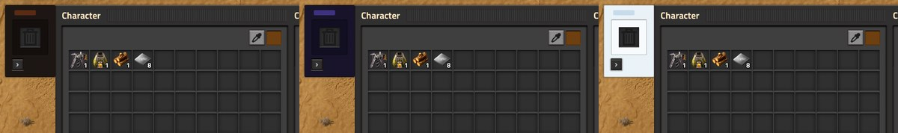

# Trash Slot

A Factorio 2.0 port of the Minecraft mod [TrashSlot](https://github.com/TwelveIterations/TrashSlot): one trash slot
attached to your inventory window (the character screen, chests, vehicles, machines).

- **Delete** on a stack you hold, or on one you hover, throws it into the slot. What was in the slot before is
  destroyed, so the slot always holds your most recent delete.
- **Shift+Delete** throws in every stack of that item (same quality).
- **Click** the slot to take the stack back. **Shift-click** puts everything back in your inventory. **Right-click**,
  or **Delete** while hovering the slot, destroys it for good. Clicking while holding a stack trashes that stack.
- **Moving it:** with [FSE](https://github.com/watdafawx/fse) (`fse-std`), drag the slot (or its bar) anywhere on the screen; it
  floats where you let go, or docks to the window when you let go against its edge (within 2 px, read from the
  game's own GUI through FSE) and shows while the inventory or a chest/machine window is open. The small grip button
  cycles left, bottom, right and top of the window, then floating again. Without FSE (or in multiplayer) the grip
  does the same, and the floating slot moves by its drag bar. Each player keeps their own place.

Items keep their data in the slot (blueprints, armor grids, spoilage). Keys only work while a window is open, and
can be rebound under Settings → Controls.

**One limit:** Lua can see which item you hover but not which slot it is in. A hovered Delete takes the last
stack of that item in your inventory (or, if you have none, in the opened chest or machine). Hold the stack first
when you need one exact stack.

Safe to add or remove at any time. Removing the mod destroys whatever is in the slot.

## Themes

The slot beside the inventory follows the theme each player picks in [FSE std](https://github.com/watdafawx/fse#themes)'s theme window (its button on the shortcut bar), when FSE std 0.6+ is installed: 12 themes, colours edited live with the FSE loader. Without FSE std it looks as before.

## Install

Copy this folder into your mods folder (`%APPDATA%\Factorio\mods`) as `trash-slot`.

`test\run.py` runs the headless tests (set `FACTORIO_EXE` if the game isn't in a usual Steam library).
`test\run_gui.py` opens a real game window and saves screenshots to `test\run\script-output` (close your own game
first).
